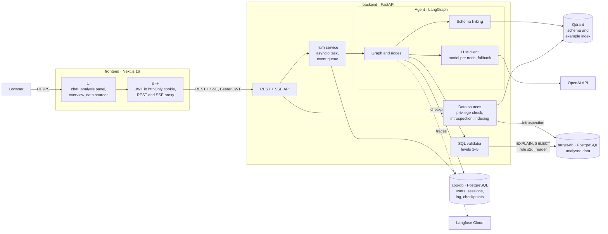
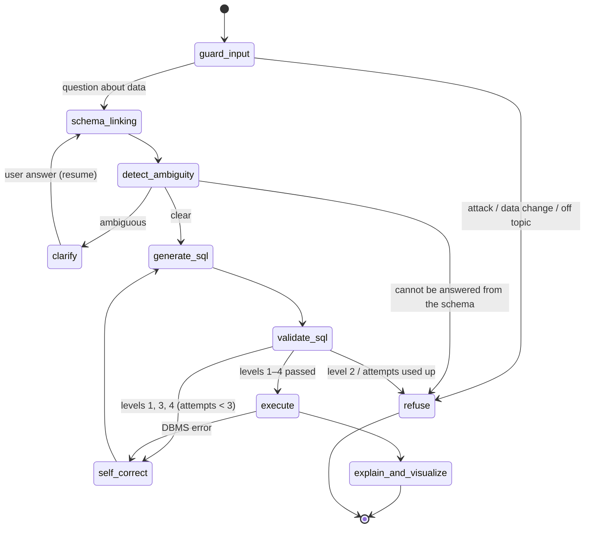
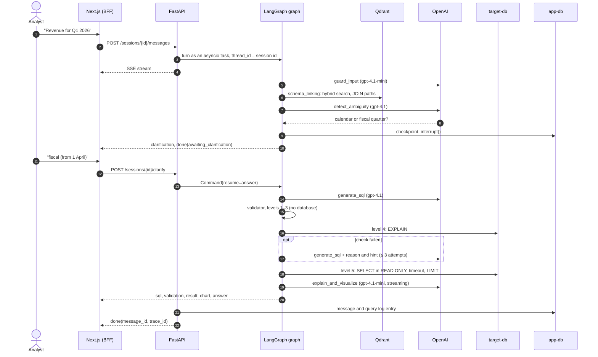

# Suhbat2DB architecture

This document describes the parts of the system, the path of one request and the reasons for the main decisions. Sections 1–7 cover the structure of the system, and section 8 collects the architectural decisions (ADRs) in the form "context, decision, consequences". The contracts between components (REST, SSE, validator, agent state) are in [docs/CONTRACTS.md](docs/CONTRACTS.md), and the evaluation results are in [EVALS.md](EVALS.md).

## Contents

1. [Components](#1-components)
2. [Deployment](#2-deployment)
3. [Agent graph](#3-agent-graph)
4. [Path of one request](#4-path-of-one-request)
5. [Data](#5-data)
6. [Lines of defence](#6-lines-of-defence)
7. [Observability and evaluation](#7-observability-and-evaluation)
8. [Architectural decisions (ADR)](#8-architectural-decisions-adr)

## 1. Components

| Component | Code | Responsible for | Does not |
|---|---|---|---|
| UI | [frontend/src/app](frontend/src/app), [components](frontend/src/components) | Chat with clarifications, analysis panel (chart, table, SQL, validation), overview, data source management | Store the token or call the backend directly |
| BFF | [frontend/src/app/api](frontend/src/app/api), [proxy.ts](frontend/src/proxy.ts) | Login and logout, JWT in an httpOnly cookie, REST and SSE proxy without buffering, rejection of requests from a foreign `Origin` ([ADR-017](#adr-017-backend-for-frontend-and-jwt-in-an-httponly-cookie)) | Contain business logic |
| REST + SSE API | [backend/app/api](backend/app/api) | Authentication, `admin` / `analyst` roles, sessions, messages, data sources, statistics. Checks run before the stream opens ([ADR-010](#adr-010-the-sse-response-is-built-by-hand)) | Know how the agent works |
| Turn service | [services/chat.py](backend/app/services/chat.py) | Runs the turn as a separate task, sends events to SSE, saves the answer and the query log entry ([ADR-019](#adr-019-the-agent-turn-does-not-depend-on-the-connection)) | — |
| Data sources | [services/datasources.py](backend/app/services/datasources.py), [indexer.py](backend/app/services/indexer.py), [target_db.py](backend/app/services/target_db.py) | Check that the connection role can only read ([ADR-008](#adr-008-read-only-check-by-role-privileges-not-by-a-test-write)), schema snapshot, sample values, indexing in Qdrant | — |
| Agent | [backend/app/agent](backend/app/agent) | A graph of 10 nodes: guard, schema linking, ambiguity detection, clarification, SQL generation, validation, self-correction, execution, explanation, refusal | Access app-db or HTTP directly; it only emits events |
| Schema linking | [agent/retrieval](backend/app/agent/retrieval) | Hybrid search over the schema and values, JOIN paths over FKs, few-shot examples ([ADR-015](#adr-015-schema-linking-text-embedding-3-large-hybrid-search-all-shortest-join-paths)) | — |
| LLM client and prompts | [llm.py](backend/app/agent/llm.py), [prompts](backend/app/agent/prompts) | Model and temperature per node, structured output, fallback provider. Prompts are stored in `*.md` files and their versions are synchronised with Langfuse ([ADR-016](#adr-016-own-llm-interface-on-top-of-langchain)) | — |
| SQL validator | [backend/app/validator](backend/app/validator) | 5 levels: syntax, read-only policy, schema, plan, isolated execution ([docs/validator.md](docs/validator.md)) | Use an LLM |

The LLM provider (the `LLM` protocol), the embedding model (its name is part of the Qdrant collection name), the agent implementation (the `AgentRunner` protocol; tests and e2e use the `AGENT_MODE=fake` stub) and the frontend, which talks to the backend only through REST and SSE, can be replaced. The validator and the introspection work only with PostgreSQL on purpose: this makes the checks more precise, although moving them to another DBMS is harder.

## 2. Deployment

`make up` starts five containers. The host ports are bound to `127.0.0.1` and are set in `.env` ([ADR-004](#adr-004-host-ports-are-set-in-env)).

| Container | Image | Port | Purpose |
|---|---|---|---|
| `frontend` | `node:24-slim` | 3000 | Next.js: UI and BFF |
| `backend` | `python:3.12-slim` | 8000 | FastAPI, agent, validator. Migrations are applied at startup |
| `app-db` | `postgres:17` | 5442 | Service data and LangGraph checkpoints |
| `target-db` | `postgres:17` | 5443 | Analysed data: the demo database and the Spider and BIRD databases for the evaluation |
| `qdrant` | `qdrant/qdrant:v1.19.2` | 6333 | Index of the schema and of "question → SQL" examples |

The only external service the agent requires is the OpenAI API. Langfuse Cloud is optional: without keys tracing is simply turned off. A local Langfuse is started with the `langfuse-local` profile and adds 6 more containers ([ADR-013](#adr-013-langfuse-cloud-by-default-local-langfuse-optional)). `app-db` and `target-db` are separated for security reasons ([ADR-002](#adr-002-separate-postgresql-instances-for-the-application-and-for-the-analysed-data)).

## 3. Agent graph

The diagram is generated from the code and is in [docs/graph.md](docs/graph.md) together with a table of nodes. A simplified version:

Each node writes the `route` field to the state, and a route function uses it to choose the next node; the LLM itself does not choose the transition. The loops have limits: self-correction makes at most 3 attempts (`AGENT_MAX_CORRECTIONS`) and clarification at most 2 rounds per question (`MAX_CLARIFICATION_ROUNDS`).

SQL errors are found by the deterministic validator; there is no second LLM acting as a critic. The generator receives the level, the reason and a hint (`feedback`) from the validator. The agent does not try to repair an attempt to modify data and refuses immediately (`fatal=True` at level 2).

The checkpoint holds only what is needed to resume: the question, the clarifications and the history. The schema snapshot, the connection pool and the limits are passed through `AgentContext` and are created again on every turn ([state.py](backend/app/agent/state.py)).

| State field | Lifetime | Purpose |
|---|---|---|
| `question`, `resolved_question`, `route`, `sql`, `attempts`, `feedback`, `result`, `answer`, `chart`, `error` | One turn | Reset at the start of a turn (`new_turn`) |
| `pending_clarification`, `turn_clarifications`, `clarification_rounds` | One question | Clarifications of the current question |
| `clarifications` (reducer `add`) | Session | Session memory: a chosen interpretation is not asked again |
| `history` (reducer `add`) | Session | Context for follow-up questions ("and by region?") |

## 4. Path of one request

Below is the path of an ambiguous question that goes through clarification and self-correction.

1. The browser talks only to Next.js. The BFF takes the JWT from the httpOnly cookie and forwards the request to FastAPI; the SSE stream passes through without buffering.
2. The API checks the session and the data source before opening the stream, so errors come back as ordinary 404, 409 and 422 codes. The turn then starts as a separate task: if the tab is closed, the answer is still saved.
3. `guard_input` stops attacks, requests to change data and questions that are not about data.
4. `schema_linking` finds the required tables with hybrid search (dense + BM25), adds the intermediate tables needed for JOINs over foreign keys and selects similar "question → SQL" examples.
5. `detect_ambiguity` decides whether the question is clear, taking the retrieved schema into account. If it is not, `interrupt()` pauses the graph, the state is saved in app-db and the user sees the options as buttons. The answer comes in a separate `POST /clarify` request, and the graph continues from the same point even if the backend has restarted in the meantime.
6. `generate_sql` builds SQL from the linked schema, the examples, the dialogue history and the errors of earlier attempts.
7. The validator checks the SQL. Levels 1–3 work without the database (< 3 ms), and level 4 runs `EXPLAIN` without `ANALYZE`. On an error the reason and the hint go back to the generator, while a violation of the read-only policy leads straight to a refusal.
8. `execute` runs the query as the `s2d_reader` role in a `READ ONLY` transaction with a `statement_timeout` of 5 s and a limit of 1000 rows.
9. `explain_and_visualize`: code chooses the chart type from the column types, the LLM writes the explanation (token streaming), and the numbers in the explanation are compared with the result.
10. The API saves the message and the query log row and sends the `done` event with `message_id` and `trace_id`, which are later used to rate the answer.

A turn costs about $0.008–0.012 and takes 4–5 s at the median ([EVALS.md](EVALS.md#summary)).

## 5. Data

| Storage | Contents | Written by | Protection |
|---|---|---|---|
| app-db | `users`, `datasources` (connection string encrypted with Fernet), `chat_sessions`, `messages`, `feedback`, `query_log`; LangGraph checkpoint tables | backend | Separate instance. SQL generated by the model runs only in target-db |
| target-db | The user's analysed data | Nobody (read-only) | Role `s2d_reader`: `SELECT`, `CONNECTION LIMIT`, `statement_timeout`, no access to system functions ([demo_db/roles.sql](demo_db/roles.sql)) |
| Qdrant | `schema_elements__<model>`: documents for tables, columns and values; `sql_examples__<model>`: verified "question → SQL" pairs. Filter by `datasource_id` | indexer | Rebuilt from the schema snapshot (`make index`), so it is not backed up |
| Langfuse | Turn traces, cost, 👍/👎 ratings, prompt versions | backend | The demo data is synthetic; real data needs a local Langfuse ([ADR-013](#adr-013-langfuse-cloud-by-default-local-langfuse-optional)) |

The demo database schema and its ambiguity "traps" are described in [docs/demo_db.md](docs/demo_db.md).

## 6. Lines of defence

The agent executes SQL that the model generated from the user's text and from data in the database. Each line of defence is therefore designed for the case when the previous one has failed.

| # | Line | Where | Protects against |
|---|---|---|---|
| 1 | Input classification | `guard_input`, prompt [guard.md](backend/app/agent/prompts/guard.md) | Direct requests to change data, prompt injection, questions not about data |
| 2 | Data separated from instructions | The schema, values and result are passed in the `<schema>` and `<query_result>` tags, the question in `<user_message>`; the prompts state that this is data | Instructions hidden in column comments and values (indirect injection) |
| 3 | Structured output | LLM decisions (guard, ambiguity, SQL) are returned as Pydantic schemas | Free text instead of a decision, route substitution |
| 4 | AST validator | Levels 1–4 ([docs/validator.md](docs/validator.md)) | DDL and DML, data-modifying CTEs, dangerous functions, system catalogs, heavy plans |
| 5 | DBMS privileges | Read-only role, privilege check when a source is registered, `READ ONLY` transaction, timeout, row limit | Anything that passed lines 1–4: the role has no write privilege at all |
| 6 | Answer check | `ungrounded_numbers` logs numbers in the explanation that are not in the result | Invented figures and instructions from data in the answer text (detection only, no blocking yet) |
| 7 | Application | JWT in an httpOnly cookie, `Origin` check, the answer is rendered without Markdown or links, argon2 passwords, secrets only in env | Session theft through XSS, CSRF, secret leaks |

On the attack set all natural-language attacks and all SQL attacks were blocked. One of six indirect injections got into the explanation text but did not affect the data ([EVALS.md](EVALS.md#security)).

## 7. Observability and evaluation

Each turn is recorded in Langfuse as a trace, and the nodes and LLM calls inside it as nested observations with tokens, cost and latency. The `trace_id` is stored with the message, and a 👍/👎 rating is attached to the trace as a score.

The main version of the prompts is kept in the [`prompts/*.md`](backend/app/agent/prompts) files in git. `make prompts` uploads them to Langfuse Prompt Management as a new version. With `PROMPTS_FROM_LANGFUSE=true` the agent takes the `production` version and links it to the generations in the traces.

The `query_log` table in app-db stores the outcome of every executed or stopped SQL query: status, the validator level where it stopped, number of rows and latency. The Overview page is built from it.

The [`backend/evals`](backend/evals) package runs the agent and the baseline on the Spider, BIRD, `ambiguous_ru` and `unsafe` sets and caches the LLM responses. A smoke set of 50 questions with regression thresholds runs in CI when the agent changes ([ADR-024](#adr-024-own-evaluation-runner-with-an-llm-cache)).

## 8. Architectural decisions (ADR)

| ADR | Decision | Status |
|---|---|---|
| [001](#adr-001-self-hosted-langfuse-instead-of-langfuse-cloud-and-langsmith) | Self-hosted Langfuse | Superseded by ADR-013 |
| [002](#adr-002-separate-postgresql-instances-for-the-application-and-for-the-analysed-data) | Separate PostgreSQL for the application and for the data | Accepted |
| [003](#adr-003-npm-instead-of-pnpm-for-the-frontend) | npm instead of pnpm | Accepted |
| [004](#adr-004-host-ports-are-set-in-env) | Host ports through `.env` | Accepted |
| [005](#adr-005-enumerations-as-varchar--check-not-native-postgresql-enum) | VARCHAR + CHECK instead of ENUM | Accepted |
| [006](#adr-006-synthetic-demo-database-with-deliberate-traps) | Synthetic demo database with "traps" | Accepted |
| [007](#adr-007-demo-database-time-zone-asiaalmaty) | Time zone Asia/Almaty | Accepted |
| [008](#adr-008-read-only-check-by-role-privileges-not-by-a-test-write) | Read-only check by role privileges | Accepted |
| [009](#adr-009-sample-column-values-through-select-distinct-not-from-statistics) | Column values through `SELECT DISTINCT` | Accepted |
| [010](#adr-010-the-sse-response-is-built-by-hand) | SSE response built by hand | Accepted |
| [011](#adr-011-sql-checks-on-the-ast-sqlglot-not-with-regular-expressions) | SQL checks on the AST (sqlglot), not with regular expressions | Accepted |
| [012](#adr-012-limit-max_rows--1-instead-of-a-separate-row-count) | `LIMIT max_rows + 1` | Accepted |
| [013](#adr-013-langfuse-cloud-by-default-local-langfuse-optional) | Langfuse Cloud by default | Accepted |
| [014](#adr-014-llm-models-gpt-41-for-precise-nodes-gpt-41-mini-for-the-rest) | gpt-4.1 and gpt-4.1-mini by node | Accepted |
| [015](#adr-015-schema-linking-text-embedding-3-large-hybrid-search-all-shortest-join-paths) | Schema linking: large embeddings, hybrid search | Accepted |
| [016](#adr-016-own-llm-interface-on-top-of-langchain) | Own LLM interface | Accepted |
| [017](#adr-017-backend-for-frontend-and-jwt-in-an-httponly-cookie) | BFF and JWT in an httpOnly cookie | Accepted |
| [018](#adr-018-chat-screen-chat--analysis-panel) | Chat + analysis panel | Accepted |
| [019](#adr-019-the-agent-turn-does-not-depend-on-the-connection) | The agent turn does not depend on the connection | Accepted |
| [020](#adr-020-agent-orchestration-langgraph-instead-of-crewai-autogen-or-an-own-loop) | LangGraph instead of CrewAI, AutoGen or an own loop | Accepted |
| [021](#adr-021-vector-index-qdrant-instead-of-pgvector) | Qdrant instead of pgvector | Accepted |
| [022](#adr-022-tracing-langfuse-instead-of-langsmith) | Langfuse instead of LangSmith | Accepted |
| [023](#adr-023-clarification-through-interrupt-and-checkpoint-instead-of-guessing) | Clarification through `interrupt` and a checkpoint | Accepted |
| [024](#adr-024-own-evaluation-runner-with-an-llm-cache) | Own evaluation runner with an LLM cache | Accepted |

## ADR-001. Self-hosted Langfuse instead of Langfuse Cloud and LangSmith

> **Superseded by ADR-013** (October 2026): Langfuse Cloud is used by default, and the self-hosted option remains as an optional profile.

**Context.** Tracing needs a tool that shows the tree of agent steps, cost and latency, and stores datasets for evals and prompt versions. Candidates: LangSmith (best integration with LangGraph, but vendor lock-in and problems with on-prem), Langfuse Cloud, self-hosted Langfuse. Self-hosted Langfuse v4 needs 6 containers (web, worker, PostgreSQL, ClickHouse, Redis, MinIO).

**Decision.** Self-hosted Langfuse in a separate compose file `infra/langfuse/docker-compose.yml`, connected through `include`. Headless initialisation (`LANGFUSE_INIT_*`) creates the organisation, the project and the keys on the first start.

**Consequences.**
- Traces and data from the user's database do not leave the machine. This matters because traces contain SQL and fragments of results.
- The environment is heavier: 11 containers. For weak machines there is `make up-lite` without Langfuse; tracing is then turned off.
- Moving to Langfuse Cloud means changing `LANGFUSE_HOST` and the keys in `.env`; the code does not change.

## ADR-002. Separate PostgreSQL instances for the application and for the analysed data

**Context.** The agent executes generated SQL. An error in the validator must not give access to the tables of users, sessions and checkpoints.

**Decision.** `app-db` (service data) and `target-db` (analysed data) are different containers with different credentials. The agent connects to `target-db` only as the `s2d_reader` role with `SELECT` privileges (role 2).

**Consequences.** Even if the validator is bypassed, a query cannot reach the service data (defense in depth). The cost is one extra container.

## ADR-003. npm instead of pnpm for the frontend

**Context.** The plan used pnpm. On the development machine corepack cannot enable pnpm without administrator rights.

**Decision.** npm (it comes with Node.js 24). The lock file is generated by the same npm version as in the `node:24-slim` Docker image; otherwise `npm ci` in the container fails because of missing optional dependencies for Linux.

**Consequences.** For a project of this size the difference is not significant. When dependencies are updated, the lock file is rebuilt with `npx npm@<image version> install --package-lock-only`.

## ADR-004. Host ports are set in .env

**Context.** On the development machine port 5432 is taken by a local PostgreSQL and port 3000 by another project.

**Decision.** All host ports are set by variables (`APP_DB_PORT`, `TARGET_DB_PORT`, `BACKEND_PORT`, `FRONTEND_PORT`) and are bound to `127.0.0.1`. Defaults: 5442, 5443, 8000, 3000.

**Consequences.** The project does not conflict with other software, and the services are not reachable from an external network.

## ADR-005. Enumerations as VARCHAR + CHECK, not native PostgreSQL ENUM

**Context.** Statuses (`role`, `status` and others) have a fixed set of values that will grow (for example, new data source statuses).

**Decision.** `VARCHAR(32)` with an explicit `CHECK (col IN (...))` defined in `__table_args__`. The automatic CHECK of `sqlalchemy.Enum` is turned off: with it, autogenerate created two identical constraints.

**Consequences.** A new value is added by a migration that replaces the CHECK, without `ALTER TYPE`, which cannot run inside a transaction in older PostgreSQL versions. The database still guarantees the integrity of the values.

## ADR-006. Synthetic demo database with deliberate "traps"

**Context.** To evaluate ambiguity clarification we need questions where several correct interpretations give **different** answers. Public benchmarks (Spider, BIRD) are built on unambiguous questions with one reference SQL.

**Decision.** An own sales database with a deterministic generator and built-in sources of ambiguity: a fiscal year that starts on 1 April, order date and payment date, several payments per order, "Almaty" as both a city and a region, current price and sale price (details in [docs/demo_db.md](docs/demo_db.md)). A test fixes the presence of each trap.

**Consequences.** The `ambiguous_ru` set is built on controlled data, and the difference between the answers for different interpretations can be measured (for example, "Q1 2026": 4,421 vs 5,054 million ₸). Limitation: the data is synthetic, so the main execution accuracy evaluation also uses Spider and BIRD.

## ADR-007. Demo database time zone: Asia/Almaty

**Context.** An order placed on 1 October at 00:30 Almaty time falls on 30 September in UTC, that is, in the previous quarter. Users ask about quarters in local time.

**Decision.** `ALTER DATABASE demo SET timezone = 'Asia/Almaty'`; timestamps are stored as `timestamptz`.

**Consequences.** `date_trunc` and the `::date` cast in the agent's SQL work in local time without an explicit `AT TIME ZONE`. For databases connected by users, the time zone is taken from their settings. It is passed to the agent as part of the schema description (role 5).

## ADR-008. Read-only check by role privileges, not by a test write

**Context.** The agent executes SQL generated by an LLM. If the connection role can write, a validator error turns into data corruption. A test write (`CREATE TEMP TABLE`) is unreliable: with `default_transaction_read_only = on` it fails even for a role with write privileges, and a session can turn this mode off itself.

**Decision.** When a source is registered, the role privileges are checked in the system catalogs: attributes (`rolsuper`, `rolcreaterole`, `rolcreatedb`, `rolbypassrls`), `CREATE`/`TEMP` on the database, `CREATE` in schemas, `INSERT/UPDATE/DELETE/TRUNCATE` on tables, membership in `pg_write_server_files`, `pg_read_server_files`, `pg_execute_server_program`. A source with any violation is not saved, and the user sees the list of violations.

**Consequences.** Level 5 of the validator relies on a guarantee of the DBMS, not on a session setting. Limitation: privileges granted after registration are not tracked. Re-checking on every connection from the pool is a possible improvement.

## ADR-009. Sample column values through SELECT DISTINCT, not from statistics

**Context.** For value linking ("Almaty" → `regions.name = 'Алматы'`) the agent needs the values of categorical columns. The `pg_stats.most_common_vals` statistic is empty for columns with unique values, which is exactly the case for lookup tables (`regions.name`, `categories.name`).

**Decision.** `pg_stats.n_distinct` is used only to select candidates (taking negative fraction values into account). The values themselves are read with `SELECT DISTINCT … LIMIT 21` in a read-only transaction with a 2 s timeout. Columns with more than 20 values are skipped.

**Consequences.** All lookup tables of the demo database have sample values; personal names and product names do not. On large tables the query is limited by the timeout and does not block indexing.

## ADR-010. The SSE response is built by hand

**Context.** In FastAPI 0.146 the built-in SSE support (`fastapi.sse`) works with generator endpoints. In those, the checks (no session, source not ready, session busy) would run after the stream had already started.

**Decision.** The endpoint is an ordinary function: first the checks with HTTP errors, then an `EventSourceResponse` with a byte generator (`format_sse_event`). The API layer between the agent and the client collects the result of the turn, saves the message and puts `message_id` into `done`.

**Consequences.** The client receives normal 404/409/422 codes before the stream opens. The agent (stub or LangGraph) knows nothing about the application database and HTTP; it only emits events.

## ADR-011. SQL checks on the AST (sqlglot), not with regular expressions

**Context.** Dangerous SQL is easy to hide from text filters: letter case (`DeLeTe`), quotes (`"pg_sleep"(10)`), comments, a data-modifying CTE inside `SELECT`, a second statement after `;`. Regular expressions give both misses and false positives (the literal `'DROP TABLE orders'`, the alias `deleted`).

**Decision.** sqlglot parses the query, and the rules are applied to the tree: an allowed root, forbidden node types anywhere, functions by name, system catalogs. Anything the parser cannot parse is rejected (allowlist).

**Consequences.** On a set of 88 attacks 100% are blocked, and on 42 harmless queries there are 0 false blocks (docs/validator.md). The project depends on sqlglot: PostgreSQL constructs it cannot parse (`NOTIFY`) are rejected as syntax errors, which is the safe side.

## ADR-012. LIMIT max_rows + 1 instead of a separate row count

**Context.** The user must know when they do not see the whole result. A separate `count(*)` query doubles the load.

**Decision.** During normalisation the outer `LIMIT` is capped at `max_rows + 1`, and the cursor reads at most `max_rows + 1` rows. If the extra row arrives, `truncated = true` is set. A smaller user `LIMIT` is kept, and a larger one is wrapped in a subquery.

**Consequences.** One query to the database and a reliable truncation flag. The SQL shown to the user contains `LIMIT 1001`, not 1000. The interface explains this (role 6).

## ADR-013. Langfuse Cloud by default, local Langfuse optional

**Context.** Self-hosted Langfuse is 6 containers (ADR-001), and it puts a noticeable load on a laptop. A Langfuse Cloud project was created for this work. The demo data is synthetic, so sending traces to the cloud is acceptable.

**Decision.** The backend sends traces to Langfuse Cloud (`LANGFUSE_BASE_URL`, project keys). The local Langfuse is moved to the `langfuse-local` compose profile (`make up-langfuse`) with its own `LANGFUSE_LOCAL_*` keys. Without keys tracing is turned off and the application still works. Tests reset the keys and do not call external services.

**Consequences.** `make up` starts 5 containers instead of 11. User databases with real data need the local option or masking; the switch is made in `.env`.

## ADR-014. LLM models: gpt-4.1 for precise nodes, gpt-4.1-mini for the rest

**Context.** Only an OpenAI key is available. The nodes have different needs: SQL generation and the ambiguity detector must reason about the schema, while guard and explanation are simple tasks. The experiment plan includes tuning `temperature`, but reasoning models (gpt-5*, the o-series) do not accept it.

**Decision.** `strong` = gpt-4.1 (`generate_sql`, `detect_ambiguity`, temperature 0), `fast` = gpt-4.1-mini (`guard_input` at 0, `explain` at 0.3). Models are set in env and can be overridden per node (for experiments). For reasoning models `temperature` is not passed. Anthropic is the fallback provider through `with_fallbacks` if its key is set.

**Consequences.** According to Langfuse, a turn costs about $0.01 (≈ 5 thousand input tokens on gpt-4.1) and takes 4–8 s. The comparison with a reasoning model (gpt-5.4-mini) is experiment 5 of role 7.

## ADR-015. Schema linking: text-embedding-3-large, hybrid search, all shortest JOIN paths

**Context.** The prompt receives only the part of the schema related to the question (just-in-time context). The selection must find all required tables; otherwise the SQL is wrong whatever the quality of the LLM.

**Decision.** Models and modes were compared on 40 questions with reference tables (share of questions where all tables were found, top-5): small dense 0.900, BM25 0.800, small hybrid 0.900, **large dense 0.975, large hybrid 0.975**. Large + hybrid was chosen: the metrics are equal, and BM25 covers exact matches of names and codes. Intermediate tables for JOINs are added along **all** shortest paths in the FK graph to the main table. The first version took a single path, and "orders in a region" was silently joined through the manager instead of the customer.

**Consequences.** On average the prompt has 5.3 of 11 tables (selection precision ≈ 0.35): extra tables cost less than missing ones. The parameters were tuned on this same set, so the independent evaluation uses other sets (role 7).

## ADR-016. Own LLM interface on top of LangChain

**Context.** Graph nodes must be tested deterministically and without a network. LangChain fake models do not support structured output.

**Decision.** The nodes depend on the `LLM` protocol (`structured`, `stream_text`). In production `LangChainLLM` is used (OpenAI/Anthropic, `with_structured_output`, `with_fallbacks`); tests use a scripted `FakeLLM` that records the prompts.

**Consequences.** 38 agent tests check routes, self-correction with a hint, clarification and session memory on the real validator and database without LLM calls. The tests also check that the validator hint reaches the generator prompt.

## ADR-017. Backend for Frontend and JWT in an httpOnly cookie

**Context.** The frontend needs a JWT for REST and an SSE stream over POST with authorisation. Keeping the token in `localStorage` is simpler, but then any XSS could steal it, and the agent's answer is text generated by an LLM from user data. The standard `EventSource` supports neither POST nor headers.

**Decision.** The browser talks only to Next.js. The `/api/auth/login` route handler gets the token from FastAPI and puts it into an httpOnly cookie (`SameSite=Lax`, `Secure` over HTTPS). The `/api/[...path]` proxy adds `Authorization: Bearer` and streams the response body, so SSE goes without buffering. Modifying requests from a foreign `Origin` are rejected: this is the second line of CSRF protection after `SameSite`. The backend address (`BACKEND_URL`) is read at runtime and is not built into the bundle.

**Consequences.** The token is not visible to JavaScript (an e2e test checks this). CORS is not needed, and the backend is not exposed. The SSE stream is parsed by an own parser (60 lines, unit tests) instead of the abandoned `@microsoft/fetch-event-source`. When the browser aborts a request, the request to the backend is aborted too.

## ADR-018. Chat screen: chat + analysis panel

**Context.** The agent's answer includes text, SQL, the report of the five validation levels, a table and a chart. If all of this is shown in the chat feed, charts and tables become small, and long answers push the dialogue out of view.

**Decision.** The chat is on the left: text, clarifications, refusals and a compact answer card. On the right is the analysis panel with the tabs Chart / Table / SQL / Validation for the selected answer; the divider can be dragged. On a phone the panel opens as a bottom sheet. A separate Overview page (`GET /api/stats`) shows a dashboard from the query log: where the validator stopped SQL, the share of answers with data, clarifications and ratings.

**Consequences.** One screen shows all three parts of the topic: the dialogue with clarification, the SQL with its validation and the result. The backend did not have to change. While the answer is being produced, the panel shows the detailed progress of the agent, and afterwards the self-correction history: each rejected attempt with the validator level and hint.

## ADR-019. The agent turn does not depend on the connection

**Context.** Originally the turn ran inside the SSE generator. If the client closed the tab or reloaded the page before the `done` event, the generator was cancelled and the answer was lost, although the LLM tokens had already been spent. An e2e test caught this in the "refusal, then reload" scenario.

**Decision.** The turn runs as a separate asyncio task (`run_turn`): events are written to a queue, the result is saved to the database, and the session is released in `finally`. The SSE generator only reads the queue. Stopping is an explicit `POST /sessions/{id}/stop`: the task is cancelled, the turn is saved with the `cancelled` error, and the stream ends normally with the `error` and `done` events.

**Consequences.** A dropped connection no longer loses the answer: it appears in the history. The Stop button stops the agent, not only the display. On application shutdown, unfinished turns are awaited (`wait_turns`).

## ADR-020. Agent orchestration: LangGraph instead of CrewAI, AutoGen or an own loop

**Context.** The agent's steps are known in advance, and there are no several agents talking to each other. The process has a loop (self-correction with up to 3 attempts), branches (refusal, clarification) and a pause while the graph waits for a human answer. The pause can last minutes and survive a backend restart, and the answer comes in a separate HTTP request. The options considered:

| Option | Loops | Human pause with saved state | Who chooses the next step | Streaming steps to the UI |
|---|---|---|---|---|
| LangChain (LCEL chains) | No | No | Code | Partly |
| CrewAI / AutoGen | Yes | Human input exists, but in the standard configuration it is not saved between HTTP requests | LLM agents (roles, agent dialogue) | Partly |
| Own loop on asyncio | Yes | Must be written by hand (serialisation, resume) | Code | Must be written by hand |
| **LangGraph** | Yes | `interrupt()` + checkpointer in PostgreSQL | Code (route functions) | `astream` by node |

**Decision.** LangGraph 1.x, a `StateGraph` of 10 nodes; route functions choose the route from the `state["route"]` field. The clarification pause uses `interrupt()`, the state is stored by `AsyncPostgresSaver` in app-db, and `thread_id` equals the chat session id. The clarification answer is passed through `Command(resume=…)`.

**Consequences.**
- Clarification works without an own persistence mechanism: the graph continues from the same node even if the backend restarted between the question and the answer.
- Session memory (chosen interpretations, question history) is kept in fields with reducers in the same checkpoints.
- The graph diagram is built from the code ([docs/graph.md](docs/graph.md)), so it matches the implementation.
- The nodes are methods of an ordinary `AgentNodes` class. They can be tested separately with a fake LLM, and the experiment configurations (without clarification, without table selection, without levels 3–4) are switched on by flags in the same graph.
- There are limitations too. The state must be serialisable, so the schema snapshot and the connection pool were moved out of it into `AgentContext`. The LangGraph API changed between versions (`interrupt`, `Command`); the version is pinned in `uv.lock`.

## ADR-021. Vector index: Qdrant instead of pgvector

**Context.** Schema linking searches over schema documents (table, column, column value) and "question → SQL" examples. It needs a filter by data source, hybrid search (by the meaning of the question and by exact names of columns and values) and Russian morphology in the lexical part. The volume is small: the demo database has a few hundred documents. The options:

| Option | Hybrid search | Filter by source | Operation |
|---|---|---|---|
| pgvector in app-db | Dense is available; the lexical part would have to be built on `tsvector` and merged by hand | SQL `WHERE` | No separate service; the index is in the same database as sessions and checkpoints |
| Chroma / FAISS inside the backend process | Dense only; BM25 must be built separately | Limited / by hand | The index lives in the process and is lost on restart, or needs its own persistence |
| **Qdrant** | Dense + sparse with server-side IDF, RRF fusion in one query | Payload index on `datasource_id` | Separate container |

**Decision.** Qdrant v1.19 as a separate container. Two collections, `schema_elements__<model>` and `sql_examples__<model>`, with named dense and sparse vectors. Term weights (TF) and tokenisation are computed by [`sparse.py`](backend/app/agent/retrieval/sparse.py): identifiers are split on `_`, and Russian and English words are stemmed (Snowball). Qdrant computes IDF (`Modifier.IDF`). Document ranks are merged with RRF and then aggregated by table.

**Consequences.**
- Hybrid search is one `prefetch` + `FusionQuery(RRF)` query, and no own BM25 implementation is needed.
- The embedding model name is part of the collection name: changing the model (comparing small and large, ADR-015) does not mix vectors of different dimensions.
- The index is separate from the service database, and reindexing does not load it.
- The price is one more container. The index is rebuilt from the schema snapshot (`make index`), so it is not included in backups. At this volume pgvector would give the same quality; the choice was decided by the built-in sparse search with IDF and by keeping the index outside app-db.

## ADR-022. Tracing: Langfuse instead of LangSmith

**Context.** We need to see the tree of agent steps with prompts, tokens, cost and latency, attach user ratings to a trace and keep prompt versions to show how they evolved. When real data is analysed, the traces must stay on our own side. The options:

| Option | LangGraph integration | Own server | Prompt management | Licence |
|---|---|---|---|---|
| LangSmith | Native | Only in the paid enterprise version | Yes | Proprietary |
| Phoenix (Arize) | Through OpenTelemetry | Yes | Limited | Open (ELv2) |
| **Langfuse** | Callback for LangChain / LangGraph | Yes (MIT, docker compose) | Yes, with the version linked to the generation | Open (MIT) |

**Decision.** Langfuse, the cloud version by default; the local one starts with a compose profile ([ADR-013](#adr-013-langfuse-cloud-by-default-local-langfuse-optional)). Traces are written through the LangChain callback handler, 👍/👎 ratings are saved as scores, and prompts are kept in Prompt Management.

**Consequences.** Moving from the cloud to an own server or back only requires changing the `.env` variables. The code is tied to the LangChain callback and otherwise does not depend on Langfuse: without keys tracing is turned off, and tests do not call external services. There is no native LangGraph graph visualisation as in LangSmith, so the graph is documented separately ([docs/graph.md](docs/graph.md)).

## ADR-023. Clarification through interrupt and checkpoint instead of guessing

**Context.** The main contribution of the work is that the agent asks the user which interpretation of an ambiguous question they meant. This can be built into the process in different ways:

| Option | Advantages | Disadvantages |
|---|---|---|
| The model chooses an interpretation itself and states it in the answer | No extra step | The user may not notice that the answer is to a different question |
| Answers for all interpretations | No dialogue | Several SQL queries per question, more cost and noise; the user has to compare the answers |
| A clarifying question as chat text, the LLM parses the answer | Simple | A free-form answer can be ambiguous again; no link to the schema columns |
| **Structured clarification: options tied to the schema + a graph pause** | The user picks with a button; the option is immediately turned into an interpretation for the generator | Requires pausing and resuming the graph (ADR-020) |

**Decision.** `detect_ambiguity` receives the question together with the retrieved schema and returns structured output: a status (`clear` / `ambiguous` / `out_of_scope`) and, for each ambiguity, its type (`metric`, `temporal`, `value`, `schema`, `scope`), the fragment of the question and 2–4 options tied to columns. The `clarify` node pauses the graph with `interrupt()`; the UI shows the options as buttons and a field for a custom answer. The choice is written to `clarifications`, and the agent does not ask it again in the same session. One question has at most 2 rounds of clarification. Explicit defaults (revenue without cancelled orders, calendar year unless the word "fiscal" is used) are written in the prompt so that obvious things are not clarified.

**Consequences.** On a set of 62 ambiguous questions clarification raised accuracy from 40.3% to 67.7% (+27.4 pp, p < 0.001); on clear questions unnecessary clarifications were 11.4% ([EVALS.md](EVALS.md#experiment-2-ambiguity-clarification)). A turn with clarification needs two HTTP requests and costs about twice as much. The detector does not yet recognise the `schema` type (which of two similar prices to use); this is a known limitation.

## ADR-024. Own evaluation runner with an LLM cache

**Context.** The experiments need execution accuracy (run the SQL and compare the result with the reference), a simulated user for clarifications, paired statistics, and reproducibility under a limited API budget. Existing tools (Langfuse Experiments, DeepEval, RAGAS) store runs and provide LLM judges. They cannot execute SQL and compare results with tolerance to row order and types, and they cannot answer an `interrupt()` of the graph.

**Decision.** The [`backend/evals`](backend/evals) package. The runner calls the same graph as the application, with configuration flags from `evals/configs/*.yaml`, and an LLM judge that knows the intended interpretation answers the clarifications. LLM responses are cached in SQLite by a hash of (node, model, temperature, seed, schema, messages) together with the original cost. The run date is fixed. Statistics use the exact McNemar test and bootstrap intervals. Runs are also written to Langfuse.

**Consequences.** Recomputing metrics and analysing errors costs nothing and gives the same result; on a cache hit the report still records the original cost of the call. Stage 1 of the evaluation cost about $5 ([EVALS.md](EVALS.md)). The evaluation package together with the dataset builders is about 3 thousand lines, and it also needs tests: there are currently 20 tests for metrics, datasets and the cache. The smoke set with regression thresholds runs in CI.
