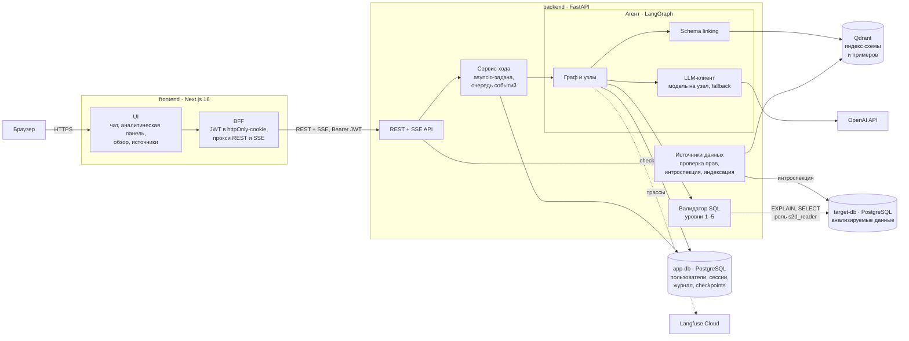
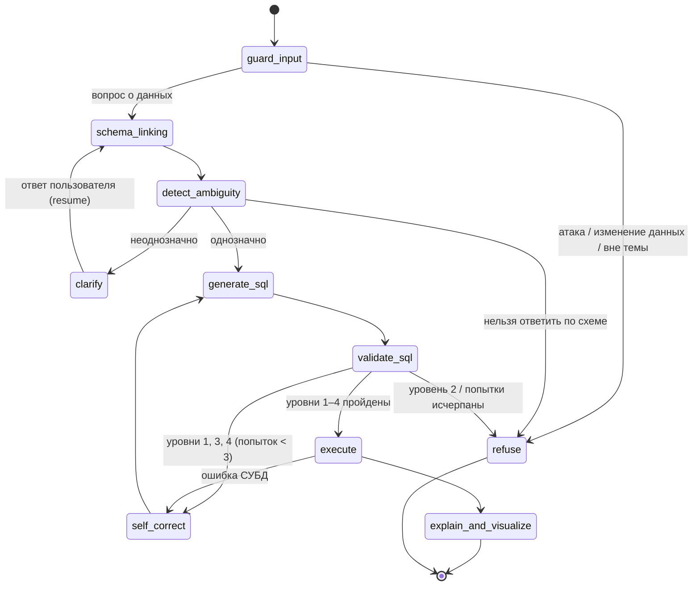
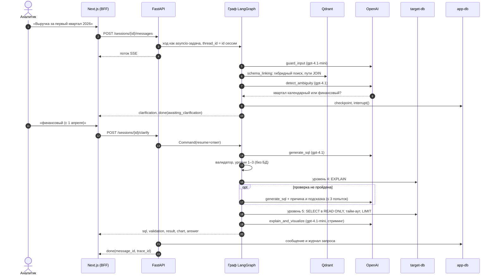

# Архитектура Suhbat2DB

Документ описывает, из чего состоит система, как проходит один запрос и почему выбраны именно такие решения. Разделы 1–7 посвящены устройству системы, раздел 8 собирает архитектурные решения (ADR) в формате «контекст → решение → последствия». Контракты между компонентами (REST, SSE, валидатор, состояние агента) описаны в [docs/CONTRACTS.md](docs/CONTRACTS.md), результаты оценки в [EVALS.md](EVALS.md).

## Содержание

1. [Компоненты](#1-компоненты)
2. [Развёртывание](#2-развёртывание)
3. [Граф агента](#3-граф-агента)
4. [Путь одного запроса](#4-путь-одного-запроса)
5. [Данные](#5-данные)
6. [Рубежи защиты](#6-рубежи-защиты)
7. [Наблюдаемость и оценка](#7-наблюдаемость-и-оценка)
8. [Архитектурные решения (ADR)](#8-архитектурные-решения-adr)

## 1. Компоненты

| Компонент | Код | Отвечает за | Не делает |
|---|---|---|---|
| UI | [frontend/src/app](frontend/src/app), [components](frontend/src/components) | Чат с уточнениями, аналитическая панель (график, таблица, SQL, проверка), обзор, управление источниками | Не хранит токен и не обращается к backend напрямую |
| BFF | [frontend/src/app/api](frontend/src/app/api), [proxy.ts](frontend/src/proxy.ts) | Вход и выход, JWT в httpOnly-cookie, прокси REST и SSE без буферизации, отклонение запросов с чужого `Origin` ([ADR-017](#adr-017-backend-for-frontend-и-jwt-в-httponly-cookie)) | Бизнес-логики нет |
| REST + SSE API | [backend/app/api](backend/app/api) | Аутентификация, роли `admin` / `analyst`, сессии, сообщения, источники, статистика. Проверки до открытия потока ([ADR-010](#adr-010-sse-ответ-формируется-вручную)) | Не знает, как устроен агент |
| Сервис хода | [services/chat.py](backend/app/services/chat.py) | Запускает ход отдельной задачей, раздаёт события в SSE, сохраняет ответ и журнал запроса ([ADR-019](#adr-019-ход-агента-не-зависит-от-соединения)) | — |
| Источники данных | [services/datasources.py](backend/app/services/datasources.py), [indexer.py](backend/app/services/indexer.py), [target_db.py](backend/app/services/target_db.py) | Проверка, что роль подключения только читает ([ADR-008](#adr-008-проверка-только-чтение-по-правам-роли-а-не-пробной-записью)), снимок схемы, примеры значений, индексация в Qdrant | — |
| Агент | [backend/app/agent](backend/app/agent) | Граф из 10 узлов: guard, schema linking, поиск неоднозначности, уточнение, генерация SQL, проверка, самокоррекция, выполнение, пояснение, отказ | Не обращается к app-db и HTTP напрямую, только отдаёт события |
| Schema linking | [agent/retrieval](backend/app/agent/retrieval) | Гибридный поиск по схеме и значениям, пути JOIN по FK, few-shot примеры ([ADR-015](#adr-015-schema-linking-text-embedding-3-large-гибридный-поиск-все-кратчайшие-пути-join)) | — |
| LLM-клиент и промпты | [llm.py](backend/app/agent/llm.py), [prompts](backend/app/agent/prompts) | Модель и temperature на узел, structured output, резервный провайдер. Промпты хранятся в файлах `*.md`, их версии синхронизируются с Langfuse ([ADR-016](#adr-016-собственный-интерфейс-llm-поверх-langchain)) | — |
| Валидатор SQL | [backend/app/validator](backend/app/validator) | 5 уровней: синтаксис, политика «только чтение», схема, план, изолированное выполнение ([docs/validator.md](docs/validator.md)) | Не использует LLM |

Заменить можно LLM-провайдера (протокол `LLM`), модель эмбеддингов (её имя входит в имя коллекции Qdrant), реализацию агента (протокол `AgentRunner`; в тестах и e2e работает заглушка `AGENT_MODE=fake`) и фронтенд, который общается с backend только через REST и SSE. Валидатор и интроспекция намеренно работают только с PostgreSQL: так проверка точнее, хотя перенести её на другую СУБД сложнее.

## 2. Развёртывание

`make up` поднимает пять контейнеров. Хост-порты привязаны к `127.0.0.1` и задаются в `.env` ([ADR-004](#adr-004-хост-порты-настраиваются-через-env)).

| Контейнер | Образ | Порт | Назначение |
|---|---|---|---|
| `frontend` | `node:24-slim` | 3000 | Next.js: UI и BFF |
| `backend` | `python:3.12-slim` | 8000 | FastAPI, агент, валидатор. Миграции применяются при старте |
| `app-db` | `postgres:17` | 5442 | Служебные данные и checkpoints LangGraph |
| `target-db` | `postgres:17` | 5443 | Анализируемые данные: демо-БД, базы Spider и BIRD для оценки |
| `qdrant` | `qdrant/qdrant:v1.19.2` | 6333 | Индекс схемы и примеров «вопрос → SQL» |

Из внешних сервисов агенту обязательно нужен OpenAI API. Langfuse Cloud необязателен: без ключей трассировка просто отключается. Локальный Langfuse запускается профилем `langfuse-local` и добавляет ещё 6 контейнеров ([ADR-013](#adr-013-langfuse-cloud-по-умолчанию-локальный--по-желанию)). `app-db` и `target-db` разделены из соображений безопасности ([ADR-002](#adr-002-отдельные-инстансы-postgresql-для-приложения-и-для-анализируемых-данных)).

## 3. Граф агента

Диаграмма сгенерирована из кода и лежит в [docs/graph.md](docs/graph.md) вместе с таблицей узлов. Упрощённо:

Каждый узел записывает в состояние поле `route`, и по нему route-функция выбирает следующий узел; сама LLM переход не выбирает. У циклов есть лимиты: самокоррекция делает не больше 3 попыток (`AGENT_MAX_CORRECTIONS`), уточнение не больше 2 раундов на вопрос (`MAX_CLARIFICATION_ROUNDS`).

Ошибки SQL находит детерминированный валидатор, второй LLM в роли критика нет. Генератор получает от валидатора уровень, причину и подсказку (`feedback`). Попытку изменить данные агент не исправляет, а сразу отказывает (`fatal=True` на уровне 2).

В checkpoint попадает только то, что нужно для продолжения: вопрос, уточнения и история. Снимок схемы, пул соединений и лимиты передаются через `AgentContext` и создаются заново на каждом ходе ([state.py](backend/app/agent/state.py)).

| Поле состояния | Время жизни | Зачем |
|---|---|---|
| `question`, `resolved_question`, `route`, `sql`, `attempts`, `feedback`, `result`, `answer`, `chart`, `error` | Один ход | Сбрасываются в начале хода (`new_turn`) |
| `pending_clarification`, `turn_clarifications`, `clarification_rounds` | Один вопрос | Уточнения текущего вопроса |
| `clarifications` (reducer `add`) | Сессия | Память сессии: выбранная трактовка не переспрашивается |
| `history` (reducer `add`) | Сессия | Контекст для уточняющих вопросов («а по регионам?») |

## 4. Путь одного запроса

Ниже путь неоднозначного вопроса, который проходит уточнение и самокоррекцию.

1. Браузер обращается только к Next.js. BFF достаёт JWT из httpOnly-cookie и передаёт запрос в FastAPI, а поток SSE пропускает без буферизации.
2. API проверяет сессию и источник до открытия потока, поэтому ошибки приходят обычными кодами 404, 409 и 422. Затем ход запускается отдельной задачей: если вкладку закрыть, ответ всё равно сохранится.
3. `guard_input` отсекает атаки, просьбы изменить данные и вопросы не о данных.
4. `schema_linking` находит нужные таблицы гибридным поиском (dense + BM25), достраивает промежуточные таблицы для JOIN по внешним ключам и подбирает похожие примеры «вопрос → SQL».
5. `detect_ambiguity` решает, однозначен ли вопрос с учётом уже найденной схемы. Если нет, `interrupt()` ставит граф на паузу, состояние сохраняется в app-db, пользователь видит варианты кнопками. Ответ приходит отдельным запросом `POST /clarify`, и граф продолжает с того же места, даже если backend за это время перезапускался.
6. `generate_sql` строит SQL по связанной схеме, примерам, истории диалога и ошибкам прошлых попыток.
7. Валидатор проверяет SQL. Уровни 1–3 работают без БД (< 3 мс), уровень 4 выполняет `EXPLAIN` без `ANALYZE`. При ошибке причина и подсказка возвращаются генератору, а нарушение политики «только чтение» сразу приводит к отказу.
8. `execute` выполняет запрос ролью `s2d_reader` в транзакции `READ ONLY` с `statement_timeout` 5 с и лимитом 1000 строк.
9. `explain_and_visualize`: тип графика выбирает код по типам столбцов, пояснение пишет LLM (стриминг токенов), числа в пояснении сверяются с результатом.
10. API сохраняет сообщение и строку журнала запросов и отправляет событие `done` с `message_id` и `trace_id`, по которым потом ставится оценка ответа.

Ход стоит около $0,008–0,012 и занимает 4–5 с по медиане ([EVALS.md](EVALS.md#главное)).

## 5. Данные

| Хранилище | Что лежит | Кто пишет | Как защищено |
|---|---|---|---|
| app-db | `users`, `datasources` (строка подключения зашифрована Fernet), `chat_sessions`, `messages`, `feedback`, `query_log`; таблицы checkpoint'ов LangGraph | backend | Отдельный инстанс. SQL, сгенерированный моделью, выполняется только в target-db |
| target-db | Анализируемые данные пользователя | Никто (только чтение) | Роль `s2d_reader`: `SELECT`, `CONNECTION LIMIT`, `statement_timeout`, без доступа к системным функциям ([demo_db/roles.sql](demo_db/roles.sql)) |
| Qdrant | `schema_elements__<модель>`: документы таблиц, столбцов и значений; `sql_examples__<модель>`: проверенные пары «вопрос → SQL». Фильтр по `datasource_id` | индексатор | Восстанавливается из снимка схемы (`make index`), поэтому не бэкапится |
| Langfuse | Трассы ходов, стоимость, оценки 👍/👎, версии промптов | backend | Демо-данные синтетические; для реальных данных нужен локальный Langfuse ([ADR-013](#adr-013-langfuse-cloud-по-умолчанию-локальный--по-желанию)) |

Схема демо-БД и её «ловушки» неоднозначности описаны в [docs/demo_db.md](docs/demo_db.md).

## 6. Рубежи защиты

Агент выполняет SQL, который модель сгенерировала по тексту пользователя и данным из БД. Поэтому каждый рубеж рассчитан на случай, когда предыдущий не сработал.

| # | Рубеж | Где | От чего защищает |
|---|---|---|---|
| 1 | Классификация входа | `guard_input`, промпт [guard.md](backend/app/agent/prompts/guard.md) | Прямые просьбы изменить данные, prompt injection, вопросы не о данных |
| 2 | Данные отделены от инструкций | Схема, значения и результат передаются в тегах `<schema>`, `<query_result>`, вопрос в `<user_message>`; в промптах прямо сказано, что это данные | Инструкции, спрятанные в комментариях к столбцам и значениях (indirect injection) |
| 3 | Structured output | Решения LLM (guard, неоднозначность, SQL) возвращаются как Pydantic-схемы | Свободный текст вместо решения, подмена маршрута |
| 4 | Валидатор по AST | Уровни 1–4 ([docs/validator.md](docs/validator.md)) | DDL и DML, изменяющие CTE, опасные функции, системные каталоги, тяжёлые планы |
| 5 | Права СУБД | Роль только для чтения, проверка прав при регистрации источника, транзакция `READ ONLY`, тайм-аут, лимит строк | Всё, что прошло рубежи 1–4: у роли физически нет права записи |
| 6 | Проверка ответа | `ungrounded_numbers` пишет в лог числа пояснения, которых нет в результате | Выдуманные цифры и инструкции из данных в тексте ответа (пока обнаружение, без блокировки) |
| 7 | Приложение | JWT в httpOnly-cookie, проверка `Origin`, ответ выводится без Markdown и ссылок, пароли argon2, секреты только в env | Кража сессии через XSS, CSRF, утечка секретов |

На наборе атак заблокированы все атаки на естественном языке и все SQL-атаки. Одна непрямая инъекция из шести попала в текст пояснения, но данные не затронула ([EVALS.md](EVALS.md#безопасность)).

## 7. Наблюдаемость и оценка

Каждый ход записывается в Langfuse как trace, а узлы и вызовы LLM внутри него как вложенные observations с токенами, стоимостью и задержкой. `trace_id` хранится в сообщении, и оценка 👍/👎 прикрепляется к trace как score.

Основная версия промптов лежит в файлах [`prompts/*.md`](backend/app/agent/prompts) в git. `make prompts` загружает их в Langfuse Prompt Management новой версией. С `PROMPTS_FROM_LANGFUSE=true` агент берёт версию `production` и связывает её с генерациями в трассах.

Таблица `query_log` в app-db хранит итог каждого выполненного или остановленного SQL: статус, уровень валидатора, на котором запрос остановлен, число строк и задержку. По ней строится страница «Обзор».

Пакет [`backend/evals`](backend/evals) прогоняет агента и baseline на наборах Spider, BIRD, `ambiguous_ru` и `unsafe`, кэшируя ответы LLM. Smoke-набор из 50 вопросов с порогами регрессии запускается в CI, когда меняется агент ([ADR-024](#adr-024-собственный-раннер-оценки-с-кэшем-llm)).

## 8. Архитектурные решения (ADR)

| ADR | Решение | Статус |
|---|---|---|
| [001](#adr-001-langfuse-self-hosted-вместо-langfuse-cloud-и-langsmith) | Langfuse self-hosted | Заменено ADR-013 |
| [002](#adr-002-отдельные-инстансы-postgresql-для-приложения-и-для-анализируемых-данных) | Отдельные PostgreSQL для приложения и данных | Принято |
| [003](#adr-003-npm-вместо-pnpm-для-фронтенда) | npm вместо pnpm | Принято |
| [004](#adr-004-хост-порты-настраиваются-через-env) | Хост-порты через `.env` | Принято |
| [005](#adr-005-перечисления-как-varchar--check-а-не-нативный-enum-postgresql) | VARCHAR + CHECK вместо ENUM | Принято |
| [006](#adr-006-синтетическая-демо-бд-с-намеренными-ловушками) | Синтетическая демо-БД с «ловушками» | Принято |
| [007](#adr-007-часовой-пояс-демо-бд--asiaalmaty) | Часовой пояс Asia/Almaty | Принято |
| [008](#adr-008-проверка-только-чтение-по-правам-роли-а-не-пробной-записью) | Проверка read-only по правам роли | Принято |
| [009](#adr-009-примеры-значений-столбцов-через-select-distinct-а-не-из-статистики) | Значения столбцов через `SELECT DISTINCT` | Принято |
| [010](#adr-010-sse-ответ-формируется-вручную) | SSE-ответ вручную | Принято |
| [011](#adr-011-проверка-sql-по-ast-sqlglot-а-не-регулярными-выражениями) | Проверка SQL по AST (sqlglot), а не регулярными выражениями | Принято |
| [012](#adr-012-limit-max_rows--1-вместо-отдельного-счётчика-строк) | `LIMIT max_rows + 1` | Принято |
| [013](#adr-013-langfuse-cloud-по-умолчанию-локальный--по-желанию) | Langfuse Cloud по умолчанию | Принято |
| [014](#adr-014-модели-llm-gpt-41-для-точных-узлов-gpt-41-mini-для-остальных) | gpt-4.1 и gpt-4.1-mini по узлам | Принято |
| [015](#adr-015-schema-linking-text-embedding-3-large-гибридный-поиск-все-кратчайшие-пути-join) | Schema linking: large-эмбеддинги, гибридный поиск | Принято |
| [016](#adr-016-собственный-интерфейс-llm-поверх-langchain) | Собственный интерфейс LLM | Принято |
| [017](#adr-017-backend-for-frontend-и-jwt-в-httponly-cookie) | BFF и JWT в httpOnly-cookie | Принято |
| [018](#adr-018-экран-диалога-чат--аналитическая-панель) | Чат + аналитическая панель | Принято |
| [019](#adr-019-ход-агента-не-зависит-от-соединения) | Ход агента не зависит от соединения | Принято |
| [020](#adr-020-оркестрация-агента-langgraph-а-не-crewai-autogen-или-собственный-цикл) | LangGraph, а не CrewAI, AutoGen или свой цикл | Принято |
| [021](#adr-021-векторный-индекс-qdrant-а-не-pgvector) | Qdrant, а не pgvector | Принято |
| [022](#adr-022-трассировка-langfuse-а-не-langsmith) | Langfuse, а не LangSmith | Принято |
| [023](#adr-023-уточнение-через-interrupt-и-checkpoint-а-не-угадывание) | Уточнение через `interrupt` и checkpoint | Принято |
| [024](#adr-024-собственный-раннер-оценки-с-кэшем-llm) | Собственный раннер оценки с кэшем LLM | Принято |

## ADR-001. Langfuse self-hosted вместо Langfuse Cloud и LangSmith

> **Заменено ADR-013** (октябрь 2026): по умолчанию используется Langfuse Cloud, self-hosted остался необязательным профилем.

**Контекст.** Для трассировки нужен инструмент, который показывает дерево шагов агента, стоимость и задержку, хранит датасеты для evals и версии промптов. Кандидаты: LangSmith (лучшая интеграция с LangGraph, но vendor lock-in и проблемы с on-prem), Langfuse Cloud, Langfuse self-hosted. Self-host Langfuse v4 требует 6 контейнеров (web, worker, PostgreSQL, ClickHouse, Redis, MinIO).

**Решение.** Langfuse self-hosted в отдельном compose-файле `infra/langfuse/docker-compose.yml`, подключённом через `include`. Headless-инициализация (`LANGFUSE_INIT_*`) создаёт организацию, проект и ключи при первом запуске.

**Последствия.**
- Трейсы и данные из БД пользователя не покидают машину. Это важно, потому что в trace попадают SQL и фрагменты результатов.
- Окружение тяжелее: 11 контейнеров. Для слабых машин есть `make up-lite` без Langfuse, трассировка тогда просто отключена.
- Переход на Langfuse Cloud — замена `LANGFUSE_HOST` и ключей в `.env`, код не меняется.

## ADR-002. Отдельные инстансы PostgreSQL для приложения и для анализируемых данных

**Контекст.** Агент выполняет сгенерированный SQL. Ошибка в валидаторе не должна дать доступ к таблицам пользователей, сессий и checkpoint'ов.

**Решение.** `app-db` (служебные данные) и `target-db` (анализируемые данные) — разные контейнеры с разными учётными данными. Агент подключается к `target-db` только ролью `s2d_reader` с правами `SELECT` (роль 2).

**Последствия.** Даже при обходе валидатора запрос физически не может обратиться к служебным данным (defense in depth). Стоимость решения — один дополнительный контейнер.

## ADR-003. npm вместо pnpm для фронтенда

**Контекст.** В плане был pnpm. На машине разработки corepack не может включить pnpm без прав администратора.

**Решение.** npm (идёт вместе с Node.js 24). Lock-файл генерируется той же версией npm, что в Docker-образе `node:24-slim`, иначе `npm ci` в контейнере падает из-за отсутствующих optional-зависимостей для Linux.

**Последствия.** Разница для проекта такого размера несущественна. При обновлении зависимостей lock-файл пересобирается командой `npx npm@<версия из образа> install --package-lock-only`.

## ADR-004. Хост-порты настраиваются через .env

**Контекст.** На машине разработки порт 5432 занят локальным PostgreSQL, порт 3000 — другим проектом.

**Решение.** Все хост-порты задаются переменными (`APP_DB_PORT`, `TARGET_DB_PORT`, `BACKEND_PORT`, `FRONTEND_PORT`) и привязаны к `127.0.0.1`. Значения по умолчанию: 5442, 5443, 8000, 3000.

**Последствия.** Проект не конфликтует с другим ПО, а сервисы недоступны из внешней сети.

## ADR-005. Перечисления как VARCHAR + CHECK, а не нативный ENUM PostgreSQL

**Контекст.** Статусы (`role`, `status` и т.п.) имеют фиксированный набор значений, который будет расширяться (например, новые статусы источника данных).

**Решение.** `VARCHAR(32)` с явным `CHECK (col IN (...))`, заданным в `__table_args__`. Автоматический CHECK у `sqlalchemy.Enum` отключён: с ним autogenerate создавал два одинаковых ограничения.

**Последствия.** Новое значение добавляется миграцией с заменой CHECK, без `ALTER TYPE`, который нельзя выполнить внутри транзакции в старых версиях PostgreSQL. Целостность значений по-прежнему гарантирует БД.

## ADR-006. Синтетическая демо-БД с намеренными «ловушками»

**Контекст.** Для оценки уточнения неоднозначности нужны вопросы, у которых несколько корректных трактовок дают **разные** ответы. Публичные бенчмарки (Spider, BIRD) построены на однозначных вопросах с одним эталонным SQL.

**Решение.** Собственная БД продаж с детерминированным генератором и встроенными источниками неоднозначности: финансовый год с 1 апреля, дата заказа и дата оплаты, несколько платежей на заказ, «Алматы» как город и область, текущая цена и цена продажи (подробно — [docs/demo_db.md](docs/demo_db.md)). Наличие каждой ловушки закреплено тестом.

**Последствия.** Набор `ambiguous_ru` строится на контролируемых данных, а расхождение ответов между трактовками измеримо (например, «первый квартал 2026»: 4 421 против 5 054 млн ₸). Ограничение: данные синтетические, поэтому основная оценка execution accuracy дополняется Spider и BIRD.

## ADR-007. Часовой пояс демо-БД — Asia/Almaty

**Контекст.** Заказ, оформленный 1 октября в 00:30 по Алматы, в UTC относится к 30 сентября, то есть к предыдущему кварталу. Пользователь спрашивает о кварталах в местном времени.

**Решение.** `ALTER DATABASE demo SET timezone = 'Asia/Almaty'`, временные метки хранятся как `timestamptz`.

**Последствия.** `date_trunc` и приведение `::date` в SQL агента работают в местном времени без явного `AT TIME ZONE`. Для подключаемых пользователем БД часовой пояс берётся из их настроек. Агенту он передаётся как часть описания схемы (роль 5).

## ADR-008. Проверка «только чтение» по правам роли, а не пробной записью

**Контекст.** Агент выполняет SQL, сгенерированный LLM. Если роль подключения может писать, ошибка валидатора превращается в порчу данных. Пробная запись (`CREATE TEMP TABLE`) ненадёжна: при `default_transaction_read_only = on` она падает и у роли с правами на запись, а этот режим сессия может отключить сама.

**Решение.** При регистрации источника права роли проверяются по системным каталогам: атрибуты (`rolsuper`, `rolcreaterole`, `rolcreatedb`, `rolbypassrls`), `CREATE`/`TEMP` на базу, `CREATE` в схемах, `INSERT/UPDATE/DELETE/TRUNCATE` на таблицы, членство в `pg_write_server_files`, `pg_read_server_files`, `pg_execute_server_program`. Источник с любым нарушением не сохраняется, а пользователь видит список нарушений.

**Последствия.** Уровень 5 валидатора опирается на гарантию СУБД, а не на настройку сессии. Ограничение: права, выданные после регистрации, не отслеживаются. Повторная проверка при каждом подключении из пула — возможное улучшение.

## ADR-009. Примеры значений столбцов через SELECT DISTINCT, а не из статистики

**Контекст.** Для value linking («Алматы» → `regions.name = 'Алматы'`) агенту нужны значения категориальных столбцов. Статистика `pg_stats.most_common_vals` пуста у столбцов с уникальными значениями, то есть как раз у справочников (`regions.name`, `categories.name`).

**Решение.** `pg_stats.n_distinct` используется только для отбора кандидатов (с учётом отрицательных значений-долей). Сами значения берутся `SELECT DISTINCT … LIMIT 21` в read-only транзакции с тайм-аутом 2 с. Столбцы с более чем 20 значениями пропускаются.

**Последствия.** Значения есть у всех справочников демо-БД, но нет у ФИО и названий товаров. На больших таблицах запрос ограничен тайм-аутом и не блокирует индексацию.

## ADR-010. SSE-ответ формируется вручную

**Контекст.** В FastAPI 0.146 встроенная поддержка SSE (`fastapi.sse`) работает с endpoint-генераторами. В них проверки (нет сессии, источник не готов, сессия занята) выполнялись бы уже после начала потока.

**Решение.** Endpoint — обычная функция: сначала проверки с HTTP-ошибками, затем `EventSourceResponse` с генератором байтов (`format_sse_event`). API-слой между агентом и клиентом собирает итог хода, сохраняет сообщение и подставляет `message_id` в `done`.

**Последствия.** Клиент получает нормальные коды 404/409/422 до открытия потока. Агент (заглушка или LangGraph) не знает о БД приложения и HTTP: он только отдаёт события.

## ADR-011. Проверка SQL по AST (sqlglot), а не регулярными выражениями

**Контекст.** Опасный SQL легко замаскировать от текстовых фильтров: регистр (`DeLeTe`), кавычки (`"pg_sleep"(10)`), комментарии, изменяющий CTE внутри `SELECT`, второе выражение после `;`. Регулярные выражения дают и пропуски, и ложные срабатывания (литерал `'DROP TABLE orders'`, псевдоним `deleted`).

**Решение.** Запрос разбирается sqlglot, правила применяются к дереву: допустимый корень, запрещённые типы узлов в любом месте, функции по имени, системные каталоги. Всё, что парсер не разобрал, отклоняется (allowlist).

**Последствия.** На наборе из 88 атак — 100% блокировок, на 42 безобидных запросах — 0 ложных (docs/validator.md). Зависимость от sqlglot: конструкции PostgreSQL, которые он не разбирает (`NOTIFY`), отклоняются как синтаксические ошибки, и это безопасная сторона.

## ADR-012. LIMIT max_rows + 1 вместо отдельного счётчика строк

**Контекст.** Пользователь должен знать, что видит не весь результат. `count(*)` отдельным запросом удваивает нагрузку.

**Решение.** При нормализации внешний `LIMIT` ограничивается значением `max_rows + 1`, курсор читает не больше `max_rows + 1` строк. Если пришла лишняя строка, ставится `truncated = true`. Меньший `LIMIT` пользователя сохраняется, больший оборачивается подзапросом.

**Последствия.** Один запрос к БД, честный признак усечения. В показанном пользователю SQL виден `LIMIT 1001`, а не 1000. Это объясняется в интерфейсе (роль 6).

## ADR-013. Langfuse Cloud по умолчанию, локальный — по желанию

**Контекст.** Self-hosted Langfuse — это 6 контейнеров (ADR-001), и он заметно нагружает ноутбук. Для проекта создан проект в Langfuse Cloud. Данные демо-БД синтетические, поэтому передача трасс в облако допустима.

**Решение.** Backend отправляет трассы в Langfuse Cloud (`LANGFUSE_BASE_URL`, ключи проекта). Локальный Langfuse вынесен в compose-профиль `langfuse-local` (`make up-langfuse`) со своими ключами `LANGFUSE_LOCAL_*`. Без ключей трассировка отключается, приложение работает. Тесты сбрасывают ключи и во внешние сервисы не ходят.

**Последствия.** `make up` поднимает 5 контейнеров вместо 11. Для пользовательских БД с реальными данными нужен локальный вариант или маскирование, переключение делается через `.env`.

## ADR-014. Модели LLM: gpt-4.1 для точных узлов, gpt-4.1-mini для остальных

**Контекст.** Ключ доступен только у OpenAI. Узлы различаются требованиями: генерация SQL и детектор неоднозначности требуют рассуждения о схеме, а guard и пояснение — простые задачи. В плане экспериментов есть подбор `temperature`, но рассуждающие модели (gpt-5*, o-серия) его не принимают.

**Решение.** `strong` = gpt-4.1 (`generate_sql`, `detect_ambiguity`, temperature 0), `fast` = gpt-4.1-mini (`guard_input` — 0, `explain` — 0,3). Модели задаются в env и переопределяются на узел (для экспериментов). Для рассуждающих моделей `temperature` не передаётся. Anthropic — резервный провайдер через `with_fallbacks`, если задан ключ.

**Последствия.** По данным Langfuse ход стоит около $0,01 (≈ 5 тыс. входных токенов на gpt-4.1) и занимает 4–8 с. Сравнение с рассуждающей моделью (gpt-5.4-mini) — эксперимент 5 роли 7.

## ADR-015. Schema linking: text-embedding-3-large, гибридный поиск, все кратчайшие пути JOIN

**Контекст.** В промпт попадает не вся схема, а связанная с вопросом часть (Just-in-Time context). Отбор должен находить все нужные таблицы, иначе SQL неверен независимо от качества LLM.

**Решение.** На 40 вопросах с эталонными таблицами сравнили модели и режимы (доля вопросов, где найдены все таблицы, top-5): small dense 0,900, BM25 0,800, small hybrid 0,900, **large dense 0,975, large hybrid 0,975**. Выбраны large + hybrid: метрики равны, а BM25 страхует точные совпадения имён и кодов. Промежуточные таблицы для JOIN добавляются по **всем** кратчайшим путям графа FK до главной таблицы. Первая версия брала один путь, и «заказы в регионе» молча связывались через менеджера вместо клиента.

**Последствия.** В промпте в среднем 5,3 таблицы из 11 (точность отбора ≈ 0,35): лишние таблицы дешевле пропущенных. Параметры подбирались на этом же наборе, поэтому независимая оценка выполняется на других наборах (роль 7).

## ADR-016. Собственный интерфейс LLM поверх LangChain

**Контекст.** Узлы графа нужно тестировать без сети и детерминированно. Фейковые модели LangChain не поддерживают structured output.

**Решение.** Узлы зависят от протокола `LLM` (`structured`, `stream_text`). В работе используется `LangChainLLM` (OpenAI/Anthropic, `with_structured_output`, `with_fallbacks`), в тестах — сценарная `FakeLLM`, которая записывает промпты.

**Последствия.** 38 тестов агента проверяют маршруты, самокоррекцию с подсказкой, уточнение и память сессии на настоящих валидаторе и БД без вызовов LLM. Тесты проверяют и то, что подсказка валидатора доходит до промпта генератора.

## ADR-017. Backend for Frontend и JWT в httpOnly-cookie

**Контекст.** Фронтенду нужны JWT для REST и поток SSE через POST с авторизацией. Хранить токен в `localStorage` проще, но тогда любой XSS (а ответ агента — текст, сгенерированный LLM по данным пользователя) может его украсть. Стандартный `EventSource` не умеет ни POST, ни заголовки.

**Решение.** Браузер обращается только к Next.js. Route handler `/api/auth/login` получает токен от FastAPI и кладёт его в httpOnly-cookie (`SameSite=Lax`, `Secure` по HTTPS). Прокси `/api/[...path]` подставляет `Authorization: Bearer` и передаёт тело ответа потоком, поэтому SSE идёт без буферизации. Изменяющие запросы с чужого `Origin` отклоняются: это второй рубеж защиты от CSRF после `SameSite`. Адрес бэкенда (`BACKEND_URL`) читается в рантайме, а не вшивается при сборке.

**Последствия.** Токен не виден JavaScript (это проверяет e2e-тест). CORS не нужен, бэкенд не публикуется наружу. Поток SSE разбирается собственным парсером (60 строк, unit-тесты) вместо заброшенной `@microsoft/fetch-event-source`. Обрыв запроса браузером обрывает и запрос к бэкенду.

## ADR-018. Экран диалога: чат + аналитическая панель

**Контекст.** Ответ агента включает текст, SQL, отчёт пяти уровней проверки, таблицу и график. Если показывать всё это в ленте чата, графики и таблицы получаются мелкими, а длинные ответы теряют диалог.

**Решение.** Слева чат: текст, уточнения, отказы и компактная карточка ответа. Справа аналитическая панель с вкладками «График / Таблица / SQL / Проверка» для выбранного ответа, разделитель перетаскивается. На телефоне панель открывается листом снизу. Отдельная страница «Обзор» (`GET /api/stats`) показывает дашборд из журнала запросов: где валидатор останавливал SQL, долю ответов с данными, уточнения и оценки.

**Последствия.** На одном экране видны все три части темы: диалог с уточнением, SQL с проверкой и результат. Бэкенд при этом менять не пришлось. Во время ответа панель показывает подробный ход агента, а после — историю самокоррекции: каждую отклонённую попытку с уровнем и подсказкой валидатора.

## ADR-019. Ход агента не зависит от соединения

**Контекст.** Изначально ход выполнялся внутри генератора SSE. Если клиент закрывал вкладку или перезагружал страницу до события `done`, генератор отменялся и ответ терялся, хотя токены LLM уже были потрачены. E2E-тест поймал это на сценарии «отказ → перезагрузка».

**Решение.** Ход выполняется отдельной asyncio-задачей (`run_turn`): события пишутся в очередь, итог сохраняется в БД, сессия освобождается в `finally`. SSE-генератор только читает очередь. Остановка — явный `POST /sessions/{id}/stop`: задача отменяется, ход сохраняется с ошибкой `cancelled`, а поток штатно завершается событиями `error` и `done`.

**Последствия.** Обрыв соединения больше не теряет ответ: он появится в истории. Кнопка «Остановить» останавливает агента, а не только отображение. При завершении приложения ожидаются незаконченные ходы (`wait_turns`).

## ADR-020. Оркестрация агента: LangGraph, а не CrewAI, AutoGen или собственный цикл

**Контекст.** Шаги агента заранее известны, и между собой несколько агентов не переговариваются. В процессе есть цикл (самокоррекция до 3 попыток), ветвления (отказ, уточнение) и пауза, во время которой граф ждёт ответа человека. Пауза может длиться минуты и пережить перезапуск backend, а ответ приходит отдельным HTTP-запросом. Рассматривались такие варианты:

| Вариант | Циклы | Пауза для человека с сохранением состояния | Кто выбирает следующий шаг | Стриминг шагов в UI |
|---|---|---|---|---|
| LangChain (LCEL-цепочки) | Нет | Нет | Код | Частично |
| CrewAI / AutoGen | Да | Ввод человека есть, но без сохранения между HTTP-запросами в стандартной конфигурации | LLM-агенты (роли, диалог агентов) | Частично |
| Собственный цикл на asyncio | Да | Писать самим (сериализация, resume) | Код | Писать самим |
| **LangGraph** | Да | `interrupt()` + checkpointer в PostgreSQL | Код (route-функции) | `astream` по узлам |

**Решение.** LangGraph 1.x, `StateGraph` из 10 узлов; маршрут выбирают route-функции по полю `state["route"]`. Для паузы на уточнение используется `interrupt()`, состояние хранит `AsyncPostgresSaver` в app-db, `thread_id` равен id сессии чата. Ответ на уточнение передаётся через `Command(resume=…)`.

**Последствия.**
- Уточнение работает без собственного механизма сохранения: граф продолжает с того же узла, даже если backend перезапускался между вопросом и ответом.
- Память сессии (выбранные трактовки, история вопросов) хранится в полях с reducer'ами в тех же checkpoint'ах.
- Диаграмма графа строится из кода ([docs/graph.md](docs/graph.md)) и поэтому совпадает с реализацией.
- Узлы написаны как методы обычного класса `AgentNodes`. Их можно тестировать по отдельности с фейковой LLM, а конфигурации экспериментов (без уточнения, без отбора таблиц, без уровней 3–4) включаются флагами в том же графе.
- Есть и ограничения. Состояние обязано сериализоваться, поэтому снимок схемы и пул соединений вынесены из него в `AgentContext`. API LangGraph менялся между версиями (`interrupt`, `Command`), версия зафиксирована в `uv.lock`.

## ADR-021. Векторный индекс: Qdrant, а не pgvector

**Контекст.** Schema linking ищет по документам схемы (таблица, столбец, значение столбца) и по примерам «вопрос → SQL». Нужны фильтр по источнику данных, гибридный поиск (по смыслу вопроса и по точным именам столбцов и значений) и русская морфология в лексической части. Объём небольшой: у демо-БД несколько сотен документов. Варианты:

| Вариант | Гибридный поиск | Фильтр по источнику | Эксплуатация |
|---|---|---|---|
| pgvector в app-db | Dense есть; лексическую часть пришлось бы собирать на `tsvector` и объединять вручную | SQL `WHERE` | Нет отдельного сервиса; индекс в той же БД, что сессии и checkpoints |
| Chroma / FAISS в процессе backend | Только dense, BM25 нужно делать отдельно | Ограниченно / вручную | Индекс живёт в процессе, теряется при перезапуске или требует своей персистентности |
| **Qdrant** | Dense + sparse с IDF на стороне сервера, слияние RRF одним запросом | Индекс по payload `datasource_id` | Отдельный контейнер |

**Решение.** Qdrant v1.19 отдельным контейнером. Две коллекции, `schema_elements__<модель>` и `sql_examples__<модель>`, с именованными dense- и sparse-векторами. Веса слов (TF) и токенизацию считает [`sparse.py`](backend/app/agent/retrieval/sparse.py): идентификаторы разбиваются по `_`, русские и английские слова приводятся к основе (Snowball). IDF считает Qdrant (`Modifier.IDF`). Ранги документов объединяются через RRF, затем агрегируются по таблицам.

**Последствия.**
- Гибридный поиск выполняется одним запросом `prefetch` + `FusionQuery(RRF)`, своя реализация BM25 не нужна.
- Имя модели эмбеддингов входит в имя коллекции: смена модели (сравнение small и large, ADR-015) не смешивает векторы разной размерности.
- Индекс отделён от служебной БД, переиндексация её не нагружает.
- Платой стал ещё один контейнер. Индекс восстанавливается из снимка схемы (`make index`), поэтому в резервные копии не входит. На таком объёме pgvector дал бы то же качество; выбор решили встроенный sparse-поиск с IDF и то, что индекс отделён от app-db.

## ADR-022. Трассировка: Langfuse, а не LangSmith

**Контекст.** Нужно видеть дерево шагов агента с промптами, токенами, стоимостью и задержкой, привязывать к трассе оценки пользователей и хранить версии промптов, чтобы показать их эволюцию. Если анализируются реальные данные, трассы должны оставаться у себя. Варианты:

| Вариант | Интеграция с LangGraph | Свой сервер | Prompt management | Лицензия |
|---|---|---|---|---|
| LangSmith | Нативная | Только в платной корпоративной версии | Да | Проприетарная |
| Phoenix (Arize) | Через OpenTelemetry | Да | Ограниченно | Открытая (ELv2) |
| **Langfuse** | Callback для LangChain / LangGraph | Да (MIT, docker compose) | Да, с привязкой версии к генерации | Открытая (MIT) |

**Решение.** Langfuse, по умолчанию в облачной версии; локальная запускается профилем compose ([ADR-013](#adr-013-langfuse-cloud-по-умолчанию-локальный--по-желанию)). Трассы пишутся через callback-обработчик LangChain, оценки 👍/👎 сохраняются как scores, промпты хранятся в Prompt Management.

**Последствия.** Чтобы перейти с облака на свой сервер или обратно, достаточно поменять переменные `.env`. Код привязан к LangChain-callback, в остальном он от Langfuse не зависит: без ключей трассировка отключается, и тесты во внешние сервисы не обращаются. Нативной визуализации графа LangGraph, как в LangSmith, здесь нет, поэтому граф документируется отдельно ([docs/graph.md](docs/graph.md)).

## ADR-023. Уточнение через interrupt и checkpoint, а не угадывание

**Контекст.** Главный вклад работы в том, что агент спрашивает пользователя, какую трактовку неоднозначного вопроса тот имел в виду. Встроить это в процесс можно по-разному:

| Вариант | Плюсы | Минусы |
|---|---|---|
| Модель выбирает трактовку сама и пишет её в ответе | Нет лишнего шага | Пользователь может не заметить, что ответ на другой вопрос |
| Перечислить ответы для всех трактовок | Без диалога | Несколько SQL на вопрос, растут стоимость и шум; сравнивать ответы должен пользователь |
| Уточняющий вопрос текстом в чате, ответ разбирает LLM | Просто | Ответ свободной формы снова может быть неоднозначен; нет связи со столбцами схемы |
| **Структурированное уточнение: варианты, привязанные к схеме, + пауза графа** | Пользователь выбирает кнопкой; вариант сразу переводится в трактовку для генератора | Нужны пауза и продолжение графа (ADR-020) |

**Решение.** `detect_ambiguity` получает вопрос вместе с уже найденной схемой и возвращает structured output: статус (`clear` / `ambiguous` / `out_of_scope`) и для каждой неоднозначности тип (`metric`, `temporal`, `value`, `schema`, `scope`), фрагмент вопроса и 2–4 варианта, привязанных к столбцам. Узел `clarify` ставит граф на паузу через `interrupt()`; UI показывает варианты кнопками и поле для своего ответа. Выбор записывается в `clarifications`, и в той же сессии агент его больше не переспрашивает. На один вопрос приходится не больше 2 раундов уточнения. Явные умолчания (выручка без отменённых заказов, календарный год без слова «финансовый») описаны в промпте, чтобы не уточнять очевидное.

**Последствия.** На наборе из 62 неоднозначных вопросов уточнение подняло точность с 40,3% до 67,7% (+27,4 п.п., p < 0,001); на однозначных лишние уточнения составили 11,4% ([EVALS.md](EVALS.md#эксперимент-2-уточнение-неоднозначности)). Ход с уточнением требует двух HTTP-запросов и стоит примерно вдвое дороже. Тип `schema` (какую из двух похожих цен брать) детектор пока не распознаёт, это известное ограничение.

## ADR-024. Собственный раннер оценки с кэшем LLM

**Контекст.** Эксперименты требуют execution accuracy (выполнить SQL и сравнить результат с эталоном), симулированного пользователя для уточнений, парной статистики и воспроизводимости при ограниченном бюджете на API. Готовые инструменты (Langfuse Experiments, DeepEval, RAGAS) хранят прогоны и дают LLM-судей. Выполнять SQL и сравнивать результаты с допуском по порядку строк и типам они не умеют, как и отвечать на `interrupt()` графа.

**Решение.** Пакет [`backend/evals`](backend/evals). Раннер вызывает тот же граф, что и приложение, с флагами конфигурации из `evals/configs/*.yaml`, а на уточнения отвечает LLM-судья, который знает задуманную трактовку. Ответы LLM кэшируются в SQLite по хэшу (узел, модель, temperature, seed, схема, сообщения) вместе с исходной стоимостью. Дата прогона фиксирована. Для статистики используются точный тест Макнемара и bootstrap-интервалы. Прогоны также пишутся в Langfuse.

**Последствия.** Повторный подсчёт метрик и разбор ошибок ничего не стоят и дают тот же результат; при попадании в кэш в отчёт всё равно записывается исходная стоимость вызова. Этап 1 оценки стоил около $5 ([EVALS.md](EVALS.md)). Пакет оценки вместе со сборкой наборов занимает около 3 тыс. строк, и их тоже нужно тестировать: сейчас есть 20 тестов метрик, наборов и кэша. Smoke-набор с порогами регрессии запускается в CI.
