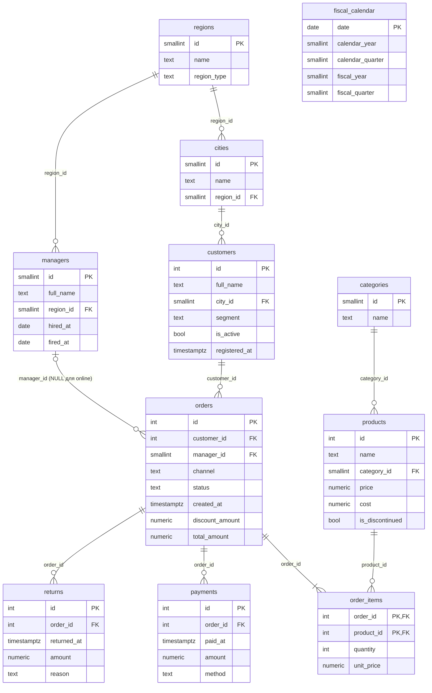

# Демо-БД Suhbat2DB

Синтетическая БД розничной сети электроники и товаров для дома в Казахстане. Используется для разработки, демонстрации на защите и для набора неоднозначных вопросов `ambiguous_ru` (роль 7).

Данные **синтетические**: их генерирует [`demo_db/seed.py`](../demo_db/seed.py) с фиксированным seed. Выводы о качестве агента на этой БД дополняются оценкой на Spider и BIRD.

## Запуск

```bash
make up-lite              # target-db должна быть запущена
make seed                 # полный объём, ~8 секунд
make seed SCALE=0.05      # 5% объёма (используется в CI)
make test-demo-db         # 68 тестов: права роли, целостность, наличие «ловушек»
```

Повторный `make seed` пересоздаёт схему `public`. Данные детерминированы: два запуска дают побайтно одинаковые таблицы.

**Подключение:** `localhost:5443`, база `demo`. Администратор — `TARGET_DB_ADMIN_USER`, агент — `s2d_reader` (пароли в `.env`).

## Объём (SCALE=1.0)

| Таблица | Строк | Содержание |
|---|---|---|
| `regions` | 12 | 3 города республиканского значения + 9 областей |
| `cities` | 16 | Города с весами по населению |
| `customers` | 30 000 | 10% организаций (b2b), 22% зарегистрированы, но ничего не покупали |
| `managers` | 56 | Менеджеры магазинов, часть уволена, часть нанята в течение периода |
| `categories` / `products` | 10 / 200 | 8% товаров сняты с продажи |
| `orders` | 100 000 | 01.10.2023 – 18.10.2026, рост ~25% в год, сезонность |
| `order_items` | ~186 000 | Цена на момент продажи (инфляция ~10% в год) |
| `payments` | ~96 000 | Часть b2b-заказов оплачена двумя платежами |
| `returns` | ~4 600 | ~5% доставленных заказов |
| `fiscal_calendar` | 1 826 | 2023–2027, финансовый год с 1 апреля |

Часовой пояс базы — `Asia/Almaty`, поэтому `date_trunc('quarter', created_at)` считает кварталы по местному времени.

## ER-диаграмма



`fiscal_calendar` не связана внешним ключом: к ней присоединяются по дате (`fiscal_calendar.date = orders.created_at::date`).

## Ловушки: источники неоднозначности

Каждая ловушка — это особенность данных, из-за которой один и тот же вопрос допускает несколько корректных SQL с **разными ответами**. Наличие каждой ловушки проверяется тестом ([`test_data.py`](../demo_db/tests/test_data.py)). Цифры ниже посчитаны на полном объёме.

### 1. «Продажи»: какой показатель (metric)

*«Покажи продажи за прошлый квартал»* (июль–сентябрь 2026):

| Трактовка | SQL-основа | Ответ |
|---|---|---|
| Выручка по дате заказа | `sum(orders.total_amount)`, без `cancelled` | 5 612,2 млн ₸ |
| Выручка по дате оплаты | `sum(payments.amount)` по `paid_at` | 5 456,5 млн ₸ |
| Выручка за вычетом возвратов | `total_amount − returns.amount` | 5 412,5 млн ₸ |
| Число заказов без отменённых | `count(*)`, `status <> 'cancelled'` | 8 471 |
| Число всех заказов | `count(*)` | 8 998 |
| Проданные единицы | `sum(order_items.quantity)` | 46 263 |
| ❌ Ошибка: `JOIN orders × payments` | сумма `total_amount` после JOIN | 6 712,1 млн ₸ (+20%) |

Последняя строка показывает типичную ошибку генерации, а не трактовку: у b2b-заказа бывает несколько платежей, поэтому JOIN дублирует строки заказа.

### 2. «Квартал» и «год»: календарный или финансовый (temporal)

Финансовый год начинается 1 апреля (`FY2026` = 01.04.2026–31.03.2027).

*«Выручка за первый квартал 2026 года»*:

| Трактовка | Период | Ответ |
|---|---|---|
| Календарный Q1 2026 | январь–март 2026 | 4 421,1 млн ₸ |
| Финансовый FQ1 FY2026 | апрель–июнь 2026 | 5 054,3 млн ₸ |

То же для «за 2025 год»: календарный 2025 или `FY2025` (апрель 2025 – март 2026).

Ещё одна временная ловушка: **дата заказа или дата оплаты**. Оплата наличными при доставке и b2b-переводы приходят через 1–10 дней, поэтому 1 655 платежей попадают в другой квартал, чем сам заказ.

### 3. «Алматы»: город или область (value)

*«Выручка в Алматы за 2025 год»*:

| Трактовка | Условие | Ответ |
|---|---|---|
| Город республиканского значения | `regions.name = 'Алматы'` | 5 433,6 млн ₸ |
| Город и Алматинская область | `regions.name ILIKE 'алмат%'` | 6 517,3 млн ₸ |

### 4. «Клиенты»: кого считать (scope)

| Трактовка | Условие |
|---|---|
| Все зарегистрированные | `customers` целиком (30 000) |
| Покупавшие хотя бы раз | `EXISTS (SELECT 1 FROM orders …)` |
| Активные | `is_active` (заказ за последние 12 месяцев) |
| Только физлица / только организации | `segment = 'b2c' / 'b2b'` |

### 5. «Лучшие менеджеры»: по какому критерию (scope)

*«Кто лучший менеджер за 2025 год?»* По выручке это **Васильев Венедикт Витальевич**, по числу заказов — **Абенова Томирис**. Кроме того, неясно, учитывать ли уволенных менеджеров (`fired_at IS NOT NULL`). Онлайн-заказы (39%) не имеют менеджера: `JOIN managers` молча их отбрасывает.

### 6. «Цена»: текущая или на момент продажи (schema)

`products.price` — текущая цена, `order_items.unit_price` — цена в момент продажи. Из-за инфляции они различаются почти во всех строках. *«Средняя цена проданных смартфонов»* даёт разные ответы в зависимости от выбранного столбца.

### 7. Отменённые заказы и статусы

6% заказов отменены. Вопрос *«сколько заказов в сентябре»* может включать их или нет. Свежие заказы бывают в статусах `new`, `paid`, `shipped`: доставлены ещё не все.

## Тесты

| Файл | Что проверяет |
|---|---|
| [`test_reader_role.py`](../demo_db/tests/test_reader_role.py) | 17 опасных команд × 2 режима (read-only сессия и сессия с отключённым read-only): DDL, DML, `SELECT INTO`, `FOR UPDATE`, data-modifying CTE, `COPY TO` файл, чтение файлов сервера. Плюс: `GRANT` не имеет эффекта, `pg_sleep(10)` прерывается тайм-аутом 5 секунд, у роли нет атрибутов суперпользователя, у `PUBLIC` нет прав на базу |
| [`test_data.py`](../demo_db/tests/test_data.py) | 11 инвариантов целостности (сумма заказа = позиции − скидка, платежи = сумме заказа, менеджер работал в дату заказа и в регионе клиента, …), комментарии у всех таблиц и столбцов, финансовый календарь, наличие всех ловушек, сезонность |

## Почему права проверяются в двух режимах

`ALTER ROLE s2d_reader SET default_transaction_read_only = on` задаёт только значение **по умолчанию**: любая сессия может выполнить `SET TRANSACTION READ WRITE`. Поэтому настоящая гарантия — **отсутствие прав** (`INSERT`, `UPDATE`, `DELETE`, `CREATE`, `TEMP`), а read-only режим лишь дополнительный слой. Второй набор тестов отключает read-only и проверяет, что запись всё равно запрещена правами.
