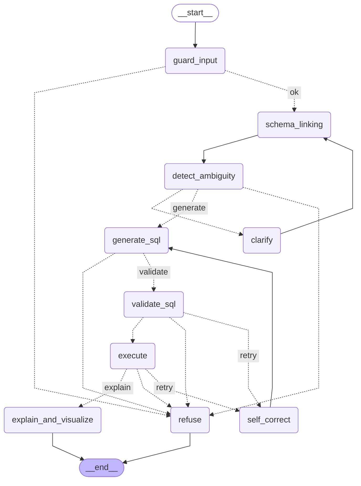

# Граф агента (LangGraph)

Сгенерировано из кода: `build_graph(...).get_graph().draw_mermaid()` ([backend/app/agent/graph.py](../backend/app/agent/graph.py)).
Пунктир — условные переходы: маршрут выбирает route-функция по полю `state["route"]`, а не LLM.

| Узел | Что делает | Модель |
|---|---|---|
| `guard_input` | Классификация: вопрос о данных / изменение данных / prompt injection / вне темы | fast |
| `schema_linking` | Гибридный поиск по схеме, достройка путей JOIN по внешним ключам, few-shot примеры | — (эмбеддинги) |
| `detect_ambiguity` | Однозначен ли вопрос; варианты трактовок привязаны к столбцам схемы | strong |
| `clarify` | `interrupt()`: граф ждёт ответа пользователя, затем продолжает с checkpoint | — |
| `generate_sql` | SQL по связанной схеме, примерам, контексту диалога и ошибкам прошлых попыток | strong |
| `validate_sql` | Уровни 1–4 валидатора ([validator.md](validator.md)) | — |
| `self_correct` | Фиксирует ошибку попытки; лимит — `AGENT_MAX_CORRECTIONS` (3) | — |
| `execute` | Уровень 5: выполнение в read-only транзакции | — |
| `explain_and_visualize` | Тип графика — кодом, пояснение — LLM (стриминг), проверка чисел | fast |
| `refuse` | Вежливый отказ с кодом причины | — |
