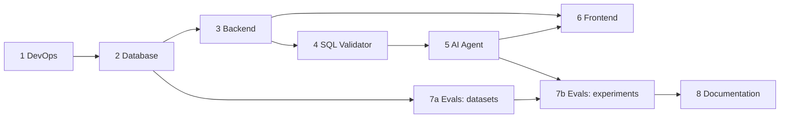

# Roles and development order of Suhbat2DB

The project is divided into 8 roles. One person carries out the project, so the roles are completed **one after another**: each role builds on the result of the previous one. The tasks inside a role are ordered as well.

The shared interfaces between roles (REST API, SSE events, agent state, validator report) are fixed in [`../CONTRACTS.md`](../CONTRACTS.md). When a contract changes, this file is edited first and the code second.

## Order

| # | Role | File | Output | Original plan | Actual / revised date |
|---|---|---|---|---|---|
| 1 | DevOps | [01_devops.md](01_devops.md) | Monorepository, docker-compose, CI; `make up` starts the whole environment | October 2026 | Done, 19.10.2026 |
| 2 | Database | [02_database.md](02_database.md) | Demo database with data and comments, read-only role, application database schema | October – November 2026 | Done, 19.10.2026 |
| 3 | Backend | [03_backend.md](03_backend.md) | FastAPI: auth, data sources, schema introspection, sessions, SSE agent stub | November – December 2026 | Done, 19.10.2026 |
| 4 | SQL Validator | [04_sql_validator.md](04_sql_validator.md) | 5-level validator and safe execution, covered by tests | December 2026 | Done, 19.10.2026 |
| 5 | AI Agent | [05_ai_agent.md](05_ai_agent.md) | LangGraph agent: schema linking, generation, self-correction, clarification, explanation | December 2026 – March 2027 | Done, 19.10.2026 |
| 6 | Frontend | [06_frontend.md](06_frontend.md) | Next.js: chat, clarifications, SQL and the validator report, table, charts | January – March 2027 | Done, 19.10.2026 |
| 7 | Evals | [07_evals.md](07_evals.md) | Datasets, runners, metrics, A/B experiments, `EVALS.md` | November 2026 (datasets) → March 2027 (experiments) | Stage 1 done 21.10.2026; stage 2 in December 2026 |
| 8 | Documentation & Defense | [08_documentation.md](08_documentation.md) | `ARCHITECTURE.md`, diploma text, presentation, demo scenario | April – May 2027 | From October 2026 (pre-defence 1 documents) until May 2027 |

## Dependencies

**Exceptions to the strict order:**

- **7a (collecting the datasets)** can start right after role 2. According to the diploma plan, the set of ambiguous questions is needed as early as October – November.
- **Frontend** can start after role 3, working with the SSE stub (mock), and switch to the real agent when role 5 is ready.

## Working rules

- Each role ends with a **Definition of Done** (DoD) at the end of its file. The next role starts only when the DoD is met.
- The tasks from the files are moved to GitHub Projects (one task per checklist item), and the branch is named `feature/<role>-<task>`. Since 22.10.2026 tasks are tracked in YouTrack instead ([docs/project](../project/README.md)).
- After each role there is a short demonstration to the supervisor (according to the plan, a monthly report).
