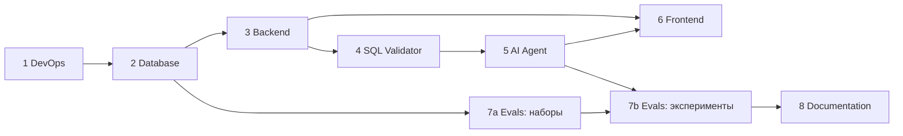

# Роли и порядок разработки Suhbat2DB

Проект разбит на 8 ролей. Проект выполняется одним человеком, поэтому роли проходятся **по очереди**: каждая следующая опирается на результат предыдущей. Внутри роли задачи тоже упорядочены.

Общие интерфейсы между ролями (REST API, SSE-события, состояние агента, отчёт валидатора) зафиксированы в [`../CONTRACTS.md`](../CONTRACTS.md). При изменении контракта сначала правится этот файл, потом код.

## Порядок

| # | Роль | Файл | Что получается на выходе | Период |
|---|---|---|---|---|
| 1 | DevOps | [01_devops.md](01_devops.md) | Монорепозиторий, docker-compose, CI, `make up` поднимает всё окружение | Октябрь 2026 |
| 2 | Database | [02_database.md](02_database.md) | Демо-БД с данными и комментариями, read-only роль, схема БД приложения | Октябрь – ноябрь 2026 |
| 3 | Backend | [03_backend.md](03_backend.md) | FastAPI: auth, источники данных, интроспекция схемы, сессии, SSE-заглушка агента | Ноябрь – декабрь 2026 |
| 4 | SQL Validator | [04_sql_validator.md](04_sql_validator.md) | 5-уровневый валидатор и безопасное выполнение, покрытые тестами | Декабрь 2026 |
| 5 | AI Agent | [05_ai_agent.md](05_ai_agent.md) | LangGraph-агент: schema linking, генерация, самокоррекция, уточнение, пояснение | Декабрь 2026 – март 2027 |
| 6 | Frontend | [06_frontend.md](06_frontend.md) | Next.js: чат, уточнения, SQL и отчёт валидатора, таблица, графики | Январь – март 2027 |
| 7 | Evals | [07_evals.md](07_evals.md) | Наборы данных, раннеры, метрики, A/B-эксперименты, `EVALS.md` | Ноябрь 2026 (наборы) → март 2027 (эксперименты) |
| 8 | Documentation & Defense | [08_documentation.md](08_documentation.md) | `ARCHITECTURE.md`, текст диплома, презентация, демо-сценарий | Апрель – май 2027 |

## Зависимости

**Исключения из строгой очерёдности:**

- **7a (сбор наборов данных)** можно делать сразу после роли 2. По плану диплома набор неоднозначных вопросов нужен уже в октябре – ноябре.
- **Frontend** можно начать после роли 3, работая с SSE-заглушкой (mock), и подключить настоящего агента, когда будет готова роль 5.

## Правила работы

- Каждая роль заканчивается **Definition of Done** (DoD) в конце своего файла. Переходить к следующей роли можно, только когда DoD выполнен.
- Задачи из файлов переносятся в GitHub Projects (одна задача на один пункт чек-листа), ветка именуется `feature/<роль>-<задача>`.
- После каждой роли делается короткая демонстрация руководителю (по плану: ежемесячный отчёт).
